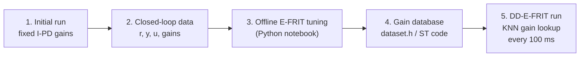
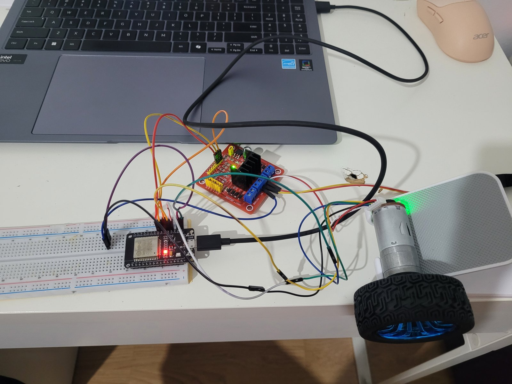
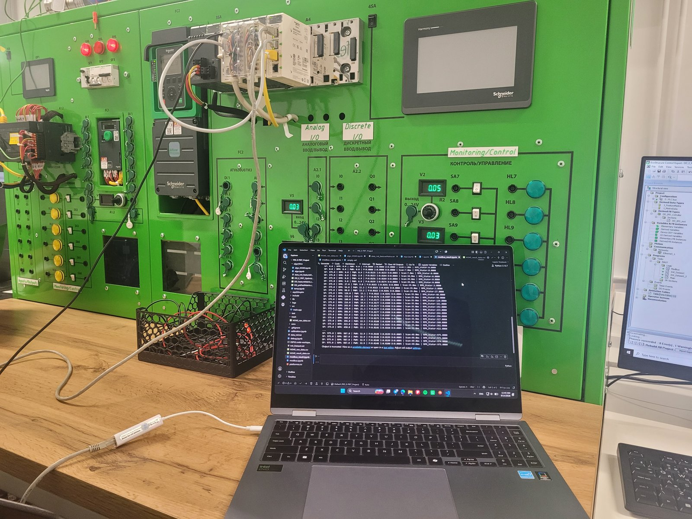
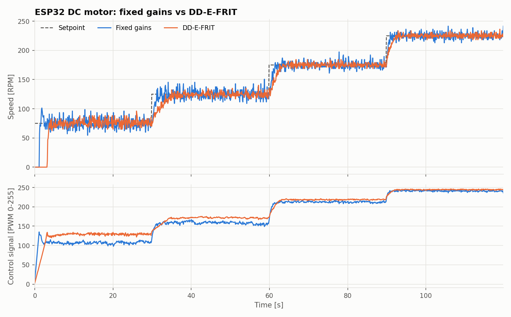
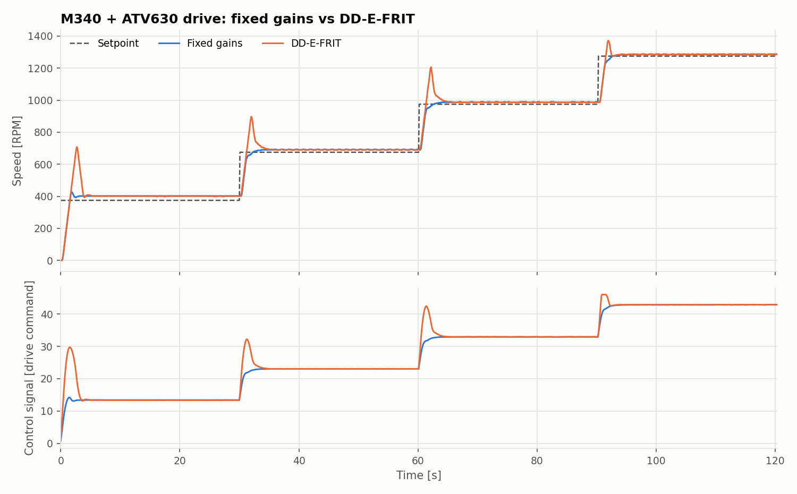
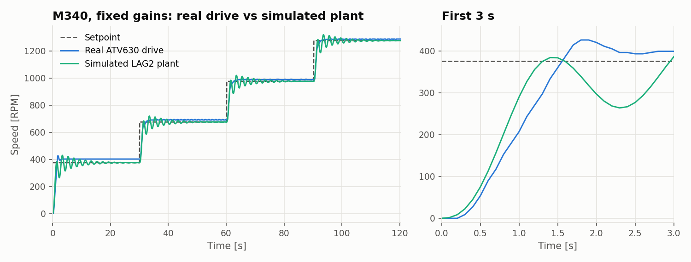

# DD-E-FRIT: data-driven PID tuning on an ESP32 and a Modicon M340 PLC

This project implements **Database-Driven E-FRIT** (DD-E-FRIT), a data-driven method for tuning PID gains, and deploys it on two controllers of very different kinds:

- an **ESP32** microcontroller controlling the speed of a DC motor (C++, PlatformIO), and
- an industrial **Schneider Modicon M340** PLC controlling an **Altivar ATV630** drive over Modbus TCP (IEC 61131-3 Structured Text, Control Expert).

No plant model is used. The controller gains come only from recorded closed-loop input/output data, which is stored in a database together with the gains tuned for each operating point. At run time, the controller looks up the gains that suit its current operating point.

The method follows Wakitani, Yamamoto and Gopaluni (2019), see [Reference](#reference). This repository is a re-implementation and deployment study, not new theory.

**Highlights**

- **ESP32:** after start-up, DD-E-FRIT reduced the tracking error by 14% and the control effort by 45% compared with fixed gains. The gain lookup takes 0.66 ms per 100 ms sample.
- **Industrial PLC:** the full method runs on a Modicon M340 in IEC 61131-3 Structured Text, controlling a real ATV630 drive over Modbus TCP.
- **A negative result, explained:** on the PLC, DD-E-FRIT did not beat fixed gains. Comparison with a simulated second-order plant and a reference-model study shows why: the drive's own speed loop hides the motor dynamics that the method learns from.

## How it works



1. **Initial run.** The controller runs with fixed gains while the setpoint steps through four levels, and every 100 ms sample is logged.
2. **Database.** Each sample becomes a record with the query vector φ(t) = [r(t+1), r(t), y(t), y(t−1), u(t−1), u(t−2)] and the gains that were active.
3. **Offline E-FRIT tuning.** For each record, the k = 20 nearest records (range-normalised L1 distance) give starting gains, which are tuned by gradient descent on the E-FRIT cost. That cost combines the error between the measured output and a second-order reference model driven by the *fictitious reference* with a λ-weighted control-effort term.
4. **Export.** The tuned database is written as a C header for the ESP32 and as Structured Text initialisation code for the M340.
5. **DD-E-FRIT run.** On the controller, each sample's query vector is compared with the database, and the gains of the 20 nearest records are averaged with weights exp(−d).

**Controller structure (I-PD).** The integral term acts on the error, while the proportional and derivative terms act on the measurement only, so setpoint steps do not kick the actuator. Velocity form: Δu(t) = Ki·e(t)·Ts − Kp·Δy(t) − Kd·Δ²y(t)/Ts.

## Hardware

| ESP32 setup | M340 setup |
|---|---|
|  |  |
| ESP32 DevKit, L298N H-bridge, geared DC motor with quadrature encoder | Schneider training stand: Modicon M340, Altivar ATV630 drive, laptop logging over Modbus TCP |

| | ESP32 setup | M340 setup |
|---|---|---|
| Controller | ESP32 DevKit v1 | Modicon M340, CPU BMX P34 2020 |
| Actuator | geared DC motor, L298N H-bridge, 8-bit PWM at 5 kHz | Altivar ATV630 variable-speed drive |
| Speed feedback | quadrature encoder, 231 pulses/rev | drive speed feedback over Modbus TCP |
| Sample time | 100 ms | 100 ms logging |
| Setpoints | 75 / 125 / 175 / 225 RPM, 30 s each | 375 / 675 / 975 / 1275 RPM, 30 s each |
| Logging | serial port → `parse_serial_log.py` | Modbus TCP → `modbus_logger.py` |

On the PLC, the I-PD law and the KNN lookup are implemented in a derived function block (`DD_IPD_Cotroller`). The drive is driven with `READ_VAR`/`WRITE_VAR` over the CPU's Ethernet port.

## Results

Metrics over the whole experiment (≈1200 samples, 120 s). The error is setpoint − speed. "TV" is the total variation of the control signal (Σ|Δu|), and Σ Δu² is the control effort.

### ESP32 (DC motor)

| Run | MAE [RPM] | RMSE [RPM] | TV Σ\|Δu\| | Σ Δu² |
|---|---|---|---|---|
| Initial, fixed gains | 6.74 | 11.44 | 2241 | 7853 |
| DD-E-FRIT | 7.09 | 15.30 | 1572 | 4108 |
| Initial, excluding first 4 s | 5.97 | 8.60 | 2045 | 6181 |
| DD-E-FRIT, excluding first 4 s | **5.14** | 9.04 | **1418** | **3416** |



- After start-up, DD-E-FRIT reduced the mean absolute error by about 14%, and the control effort by 31% (TV) and 45% (Σ Δu²). The PWM signal was clearly smoother.
- At start-up, the motor stayed stalled for 3.2 s with the tuned gains, against 1.2 s with the fixed gains. That start-up stall is what makes the whole-run RMSE worse.
- Measured lookup time on the ESP32 (20-NN query over 1193 records, single-precision float): 0.66 ms on average, 2.43 ms at most, against a 100 ms sample period.

### M340 + ATV630

| Run | MAE [RPM] | RMSE [RPM] | TV Σ\|Δu\| | Σ Δu² |
|---|---|---|---|---|
| Initial, fixed gains | 24.43 | 49.79 | 49.7 | 41.4 |
| DD-E-FRIT | 30.80 | 61.03 | 123.4 | 201.0 |



- On the PLC, DD-E-FRIT did **not** improve on the fixed gains: it overshoots at every setpoint step, and tracking error and control activity were both higher.
- The ATV630 runs its own internal speed loop, so the PLC sees the drive's closed-loop response rather than the motor's dynamics. The reported speed moves in 3-RPM steps and settles 11-27 RPM above the setpoint, on the same plateaus in both runs. Together these give the data-driven tuning very little dynamic information to work with (see the LAG2 comparison below).
- The deployment itself works end to end: the PLC runs the database lookup online while it controls a real industrial drive.

### M340: effect of the reference-model rise time

Earlier DD-E-FRIT runs on the same real drive, each tuned with a different rise time for the reference model Td(z):

| Rise time | Ts in tuning | MAE [RPM] | RMSE [RPM] | TV Σ\|Δu\| | Σ Δu² |
|---|---|---|---|---|---|
| 0.1 s | 0.3 s | **27.1** | **52.4** | 82.9 | 106.1 |
| 0.5 s | 0.1 s | 31.0 | 59.6 | 46.7 | 18.2 |
| 2 s | 0.1 s | 53.2 | 89.9 | 46.8 | **6.5** |

A slower reference model asks for a gentler response, so the tuned gains give a much smoother control signal (Σ Δu² falls by a factor of 16) at the cost of larger tracking error. This is the trade-off that the E-FRIT cost function expresses. Data: `data/m340/rise_time_study/`, notebooks: `algorithm/archive/m340_rise_time_study/`.

### M340: LAG2 simulation mode

Because the drive's speed loop masks the motor dynamics, the PLC project can also replace the drive with a simulated second-order plant. When `bLagSim` is TRUE, the frequency command goes through Control Expert's `LAG2` block, and its output becomes the speed feedback:

$$
G(s) = \frac{K}{1 + \dfrac{2\zeta}{\omega_n}\,s + \left(\dfrac{s}{\omega_n}\right)^2}
$$

with K = `gain`, ζ = `dmp` and ω<sub>n</sub> = `freq`. The block integrates it with a backward-Euler step over the task period Δt:

$$
y_k = \frac{K(\omega_n \Delta t)^2\,x_k + (2 + 2\zeta\omega_n\Delta t)\,y_{k-1} - y_{k-2}}{1 + 2\zeta\omega_n\Delta t + (\omega_n\Delta t)^2}
$$

The output is a frequency in 0.1 Hz units, converted to speed as rpm = y / 10 × 30 (30 RPM per Hz).

With the same fixed gains, the two plants behave very differently:



The simulated plant shows a lightly damped second-order response and settles on the setpoint. The real drive follows its own acceleration ramp, a straight line in the zoomed view, and settles above the setpoint. A data-driven method can only learn the dynamics that are visible in the data, and the drive hides most of them.

Data in `data/m340/lag2_sim/`: the full fixed-gain run on the simulated plant (`initial_run_freq1.5.csv`; the original file name gives `freq` = 1.5) and a short 13-second DD-E-FRIT test. A full DD-E-FRIT run on the simulated plant was not recorded.

## Repository layout

```
algorithm/
  esp32_dd_efrit_tuning.ipynb      offline tuning + evaluation, ESP32
  m340_dd_efrit_tuning.ipynb       offline tuning + evaluation, M340
  m340_normalization_ranges.ipynb  normalisation constants for the PLC
  output/                          files generated by the notebooks
  archive/                         early exploration and the M340 rise-time study
esp32/                             PlatformIO project (open this folder in VS Code)
  src/main.cpp                     experiment: sampling, setpoint schedule, logging
  include/PIDcontroller.h          I-PD law and KNN gain lookup
  include/dataset.h                tuned gain database (generated)
  tools/parse_serial_log.py        serial log -> CSV
m340/
  dd_e_frit_m340.stu               Control Expert project (V15.0 or newer)
  tools/modbus_logger.py           Modbus TCP logger -> CSV
data/
  esp32/                           initial and DD-E-FRIT runs, raw serial logs
  m340/                            initial and DD-E-FRIT runs
    rise_time_study/               DD-E-FRIT runs with different reference models
    lag2_sim/                      runs with the simulated LAG2 plant
docs/
  images/                          photos of both setups
  figures/                         result figures
  make_figures.py                  regenerates the figures from data/
```

## Reproducing

**Python** (notebooks and tools):

```bash
python -m venv venv
venv\Scripts\activate          # Windows; on Linux/macOS: source venv/bin/activate
pip install -r requirements.txt
jupyter lab                    # open the notebooks in algorithm/
```

Run the notebooks from the `algorithm/` folder. Running `esp32_dd_efrit_tuning.ipynb` regenerates `esp32/include/dataset.h`. The README figures are regenerated with `python docs/make_figures.py` from the repository root.

**ESP32 firmware** (PlatformIO):

```bash
cd esp32
pio run -t upload               # initial run, fixed gains
pio run -e dd_efrit -t upload    # DD-E-FRIT run (gain lookup + timing)
pio device monitor               # press any key to start; the log2file filter saves the log
python tools/parse_serial_log.py <log file> <output.csv>
```

**M340:** open `m340/dd_e_frit_m340.stu` in EcoStruxure Control Expert V15.0 or newer. Log a run with `python m340/tools/modbus_logger.py <output.csv> --host <PLC IP>`.

## Reference

S. Wakitani, T. Yamamoto and R. B. Gopaluni, "Design and application of a database-driven PID controller with data-driven updating algorithm," *Industrial & Engineering Chemistry Research*, vol. 58, no. 26, pp. 11419–11429, 2019. [doi:10.1021/acs.iecr.9b00704](https://doi.org/10.1021/acs.iecr.9b00704)

## Author

Daniyar A. Tazhimbetov, Automation and Control, KBTU.
Licensed under the MIT License (see `LICENSE`).
